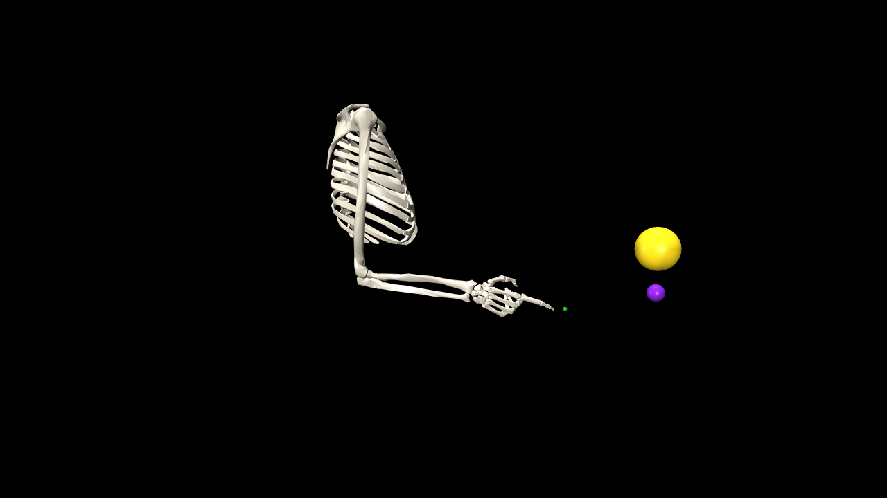
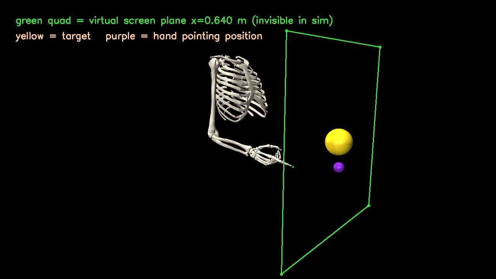
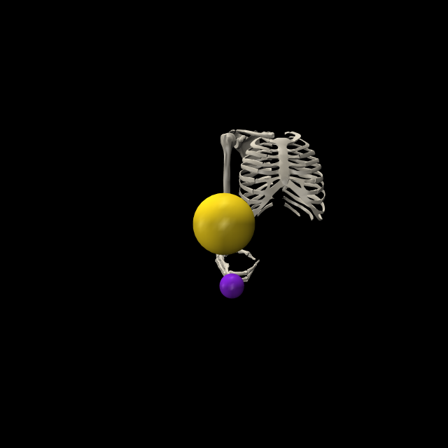
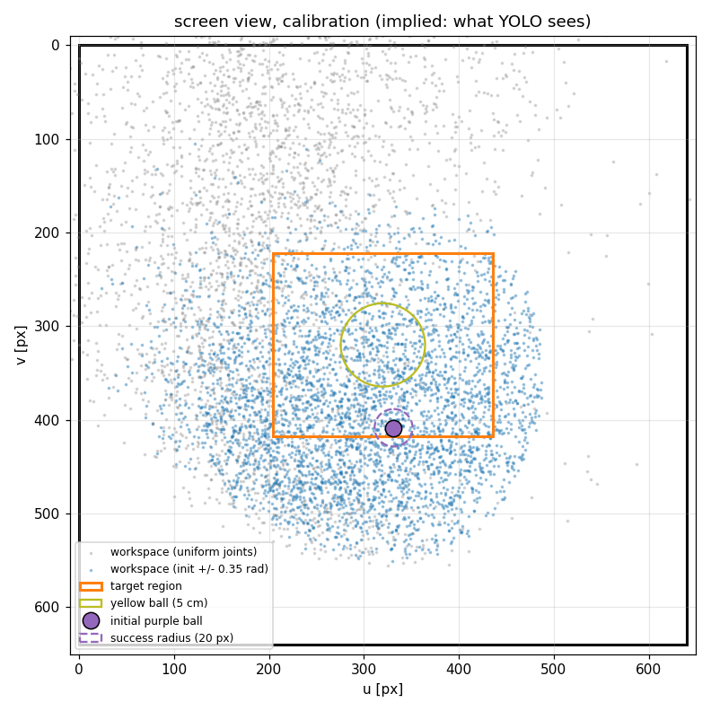
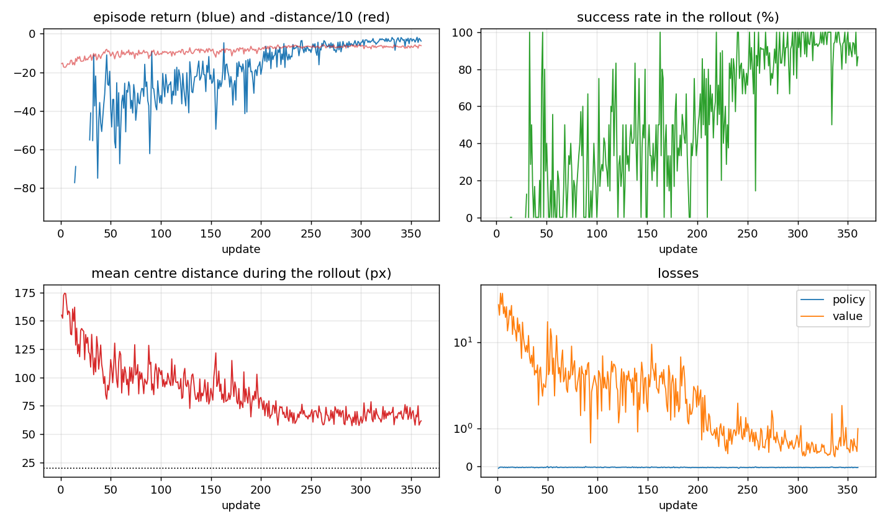
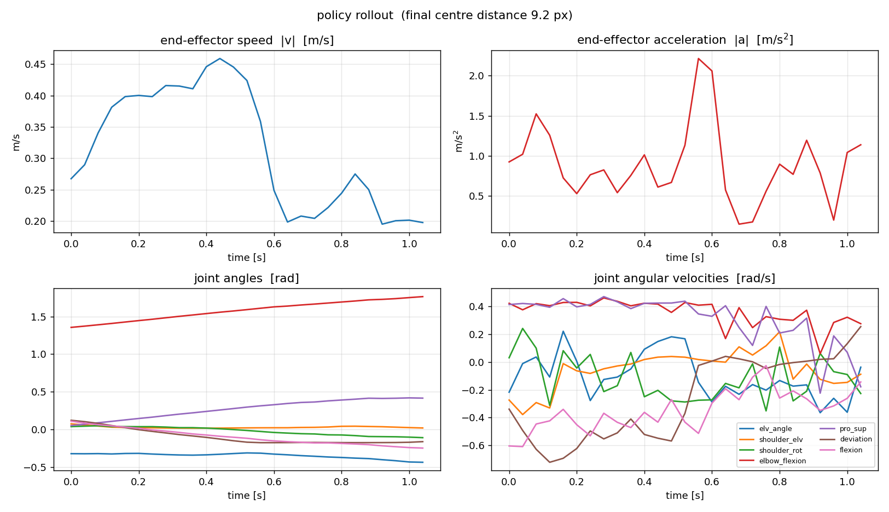
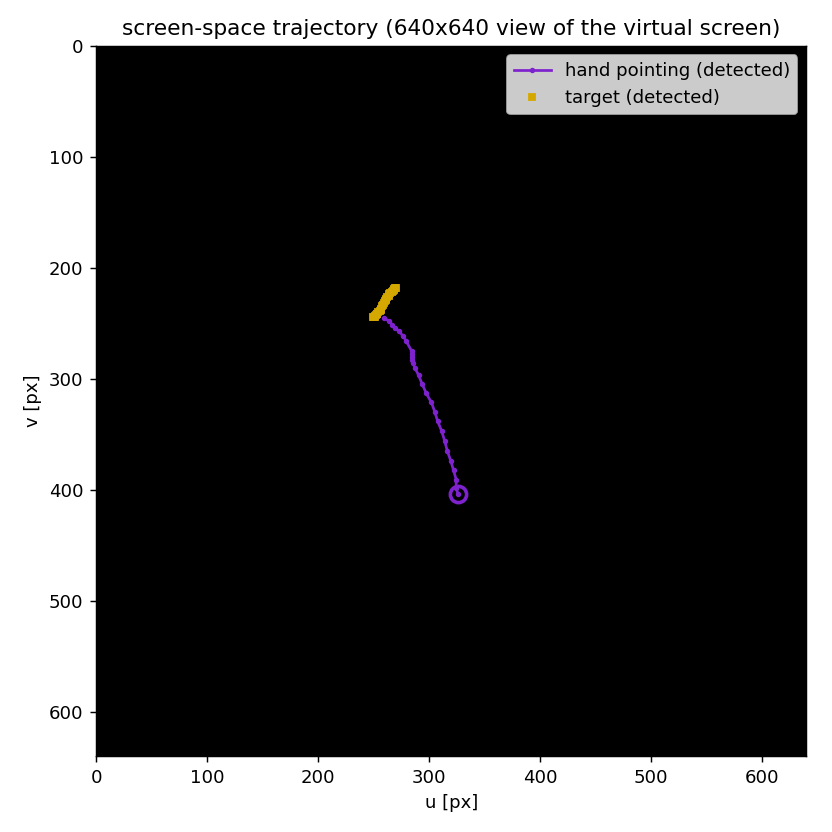

# SimRL — MuJoCo 视觉指向任务 + PPO

一个人体骨骼模型（`models/test.xml`：胸廓 + 右臂，26 DoF）站在一块**虚拟屏幕**前 55 cm，
必须在屏幕上用指尖对准一个**随机出现、并且一直轻微摆动**的黄色目标球。
智能体只能看到一块 640×640 的"屏幕画面"（用 `yolo_model/best.pt` 检测两个球心）加上本体感受，
动作是 7 个手臂关节的**位置增量**，力矩由逆动力学求出并按执行器限幅，
策略用连续动作空间的 PPO 训练。

最终产物：

| 文件 | 内容 |
| --- | --- |
| `log/ppo_ckpt.pt`, `log/ppo_best.pt` | 训练得到的策略 / 价值网络 + 观测归一化统计 |
| `log/ppo_log_merged.csv` | 每次 PPO 更新的训练指标（控制台也会实时打印；`clean_log.py` 把多段接力的日志拼成连续编号） |
| `log/ppo_curves.png` | 训练曲线（回报、成功率、距离、loss） |
| `log/eval_curves.png` | **最终策略单次运行**：末端速度/加速度、7 关节角度、7 关节角速度 |
| `log/eval_trajectory.png` | 屏幕上指尖轨迹 vs 目标 |
| `log/demo.mp4` | 演示视频（第三人称全景，拍到完整人体模型 + 右下角策略视角内嵌） |
| `log/eval_stats.json` | 上述运行的数值统计 |

---

## 1. 目录结构

```
SimRL/
├── models/                     # 原始素材（未改动）
│   ├── test.xml                # 人体骨骼模型（26 DoF，7 个驱动关节）
│   ├── 场景示例图.png
│   └── Geometry/*.stl
├── yolo_model/best.pt          # 两个球的检测器
├── assets/scene.xml            # 由 models/test.xml 自动生成的实验场景
├── simrl/
│   ├── config.py               # 所有物理/几何/超参数常量
│   ├── scene.py                # 生成 scene.xml（删多余几何、加屏幕相机、加两个球）
│   ├── kinematics.py           # 模型信息、qpos 重建、屏幕投影、摆动
│   ├── control.py              # 位置伺服 + 逆动力学 + 力矩限幅
│   ├── detector.py             # YOLO 推理（一次调用检测两张球 → 中心像素）
│   ├── env.py                  # 向量化环境（8 个并行副本，共享渲染器和检测器）
│   └── ppo.py                  # Actor-Critic、GAE、PPO 更新
├── solve_init_pose.py          # 解初始姿态（上臂下垂、前臂朝前、肘角 ~100°）
├── calibrate.py                # 标定脚本：工作空间采样（复现屏幕尺寸/位置）
├── calib_screen.py             # 屏幕尺寸/位置的网格搜索
├── train.py                    # 训练入口
├── clean_log.py                # 多段训练日志拼接 + 重画曲线
└── evaluate.py                 # 用最终策略跑一局，出图 + 视频
```

## 2. 运行环境

* Python 3.12 + `mujoco 4.0.1`、`torch 2.9.1+cu126`、`ultralytics`、`numpy`、`matplotlib`、`opencv-python`
* 需要 NVIDIA GPU（本项目在 RTX 4060 Laptop 上完成训练）

> **⚠️ Windows 上必须设的环境变量（否则 numpy/matplotlib 会静默崩溃）**
> 本机 anaconda 的 numpy 链接 MKL 单动态库，而 `Library/bin` 里缺少 `libiomp5md.dll`，
> 任何二维 `np.dot`/`matmul`/matplotlib 都会以 `0xC06D007E`（退出码 3228369022）直接杀掉进程。
> `simrl/__init__.py` 在 import numpy **之前**设置了：
> ```python
> os.environ.setdefault("MKL_THREADING_LAYER", "SEQUENTIAL")
> os.environ.setdefault("KMP_DUPLICATE_LIB_OK", "TRUE")
> ```
> 因此只要 `import simrl`（或任何入口脚本）在先，就不会崩。手动跑命令行时也建议
> `set MKL_THREADING_LAYER=SEQUENTIAL`。

## 3. 场景是怎么搭的（`simrl/scene.py`）

`build_scene()` 从 `models/test.xml` 读入 XML，然后：

1. **删掉与实验无关的东西**：背景板、桌面、坐标轴箭头、`target`/`target1..13` 幽灵球、
   原来的 `cursor` 球、`cameramover/cameraturner` 相机架、`accelerometer` 传感器。
   剩下的一律保留（骨骼、mesh、关节、equality 约束、7 个 `motor` 执行器、关键帧）。
2. 插入 `<visual><global offwidth="1280" offheight="720">`，MuJoCo 的离屏渲染
   缓冲区必须 ≥ 请求尺寸，否则 `Renderer` 直接报错。
3. 加两个 **mocap 刚体**（不受物理影响，每帧由代码摆放）：
   * `target_ball`：黄色球 RGB(250,215,30)，半径 0.05 m → 屏幕上直径约 89 px
   * `cursor_ball`：紫色球 RGB(126,34,206)，半径 0.02 m → 屏幕上直径约 36 px
     （`contype=conaffinity=0`，不参与碰撞）
4. 加两台相机：
   * `screen_cam`：在屏幕平面**前方** 0.55 m、朝 -X 看（即"从屏幕后面看人体"），
     `fovy` 由屏幕尺寸反算（`SCREEN_SIZE=0.72 m` → 66.4°），它拍到的画面就是"屏幕显示的内容"。
   * `demo_cam`：第三人称，拍到完整人体 + 两球，只用于演示视频。

### 屏幕几何

模型坐标系 **Y 向上、X 向前（从胸口指向外）、Z 指向模型左侧**。
胸廓 STL 的最前表面在 `x = +0.09014 m`，屏幕平面就是**垂直于 X 轴**的那张平面：

```
屏幕平面   x = 0.09014 + 0.55 = 0.64014 m      （法向 +X，与胸部法向平行）
屏幕中心   (y, z) = (-0.30, 0.20) m
屏幕边长   S = 0.72 m
屏幕相机   (0.64014 + 0.55, -0.30, 0.20) = (1.19014, -0.30, 0.20)，看向 -X
```

相机正对平面、平视，所以屏幕 → 像素是纯缩放映射（平面局部坐标 `right = -Z_world`、`up = +Y_world`）：

```
u = 320 + (640 / S) * (-p_z)      v = 320 - (640 / S) * p_y
```

其中 `(p_y, p_z)` 是点相对屏幕中心的相对坐标（米），`640/S = 888.9 px/m`
（屏幕上的 1 cm ≈ 8.9 px；黄球直径 89 px、紫球 36 px）。

**初始姿态**（`solve_init_pose.py` 用 L-BFGS-B 多起点解出来的）：
上臂竖直下垂、前臂朝前、肘**内角 100.1°**（比直角略大），正是"自然坐/站姿抬手指屏幕"：

| 量 | 值 |
|---|---|
| `INIT_Q7` | (−0.3159, 0.0782, 0.0359, 1.3419, 0.0363, 0.1267, 0.1229) rad |
| 肩 / 肘 / 指尖 | (−0.020, −0.007, 0.182) / (−0.020, −0.355, 0.193) / (0.436, −0.437, 0.183) m |
| 上臂方向 | (0.001, −0.999, 0.032) → 竖直向下 |
| 前臂方向 | (0.984, −0.176, −0.023) → 朝前、向下 10° |
| 初始紫球 | 屏幕像素 **(331, 408)**，且 100% 的自然工作空间都落在 640×640 画面内 |

初始姿态写在 `config.INIT_Q7` 里，由 `ModelInfo.dependent_qpos()` 展开成 26 维 `qpos`
（13 条 equality 约束的从动关节由主关节算出），**不使用 `test.xml` 里的 `Init` 关键帧**
（那个关键帧是直臂前伸的原始姿态，`test.xml` 本身没有被修改）。

侧视图（与需求给的投影图一致：上臂下垂、前臂朝前、肘角略大于 90°）：



第三人称（绿框是画出来的虚拟屏幕平面，仿真里不可见；黄=目标，紫=手部指向）：



策略实际看到的 640×640 画面（初始姿态那一刻，目标放在屏幕中心）：



目标只在 `target_region = x∈[-0.13,0.13], y∈[-0.11,0.11]`（米，平面局部坐标）的矩形内均匀采样，
映射到像素 `u∈[204,436], v∈[222,418]`，加上黄球半径 44 px、摆动余量后
**整颗球始终留出 ≥ 100 px 边距**——满足"球必须完整地在 640×640 画面内"的要求。
新目标还会保证离起始光标至少 120 px（`target_min_start_px`），避免开局就落在成功圈里。

可达工作空间与目标区的标定图（`log/calibration_screen.png`）：



### 摆动（`SwayConfig`）

需求 2 要求"目标球和指尖都持续摆动"。人体本身不动（否则基座被扰动力驱动会破坏
逆动力学的可重复性），而是**相机 + 屏幕（即整个视觉装置）作为刚体缓慢摆动**：
平移幅度 (2.0, 2.0, 1.5) cm、绕屏幕中心旋转 (2.0, 2.0, 1.5)°、频率 0.25–0.60 Hz，
每个回合随机相位。这对模型来说等价于"世界在晃、我盯着屏幕指"。
另外黄球在平面内还有 ±1.4 cm 的独立二维摆动（0.20–0.50 Hz），
让"两个球都在动"在画面里真实可见。两组参数都在 `config.py` 里，可单独关掉。

## 4. 观测、动作、奖励（`simrl/env.py`）

### 观测（25 维）

```
[ 黄球中心 u,v , 紫球中心 u,v ]  (4)   ← 像素坐标归一化到 [-1,1]，再裁剪到 ±3
[ 7 个关节角 q ]                 (7)   ← 用关节限位归一化到 [-1,1]
[ 7 个关节角速度 dq ]            (7)   ← 除以 5 rad/s，裁剪 ±3
[ 7 个关节角加速度 ddq ]         (7)   ← 除以 150 rad/s²，裁剪 ±3
```

两个球心**来自 YOLO 检测**：每步把 8 个环境的屏幕画面拼成一个 batch，
一次前向得到两个目标类的最高置信度锚框，取 top-5 锚框的置信度加权平均中心
（球是单实例，不需要 NMS）。实测中心误差 ≈ 1 px（p95 < 2 px）。

两条安全网（都会被统计进 CSV 的 `det_fallback` / `det_occluded`）：

* **置信度 < 0.2** 或 **检测框直径超出合理范围**（黄 45–160 px，紫 15–80 px）时，
  说明检测器这一帧不可信（实测出现过回归头退化，框会塌到 (0,0)），
  此时用解析投影（真实几何值）代替。
* **遮挡检测**：用 `mj_ray` 从相机向球心投射，若被身体挡住则同样用解析值。
  手掌占满画面时，检测器会在骨头上产生高置信度误检，两个球心重合 → 距离为 0 →
  奖励被 hack。射线判定把这种退化挡在奖励之前。

### 动作 → 力矩

策略输出 7 维 `a ∈ [-1,1]`，对应 7 个关节的**位置增量**（`max_action = 0.05 rad`）：

```
q_des = clip(q_start + 0.05 * a, 关节限位)
tau   = kp * (q_des - q) - kd * dq + tau_hold        # 前馈保持重力/惯量项
tau   = clip(tau, 执行器力矩下限, 上限)               # 由 gear × ctrlrange 得到，非对称
```

* `tau_hold` 由 `mj_inverse` 求出（把重力、科氏力、约束力全部算进去，
  用 `qfrc_inverse` 的关节分量），保证"零误差时不需要额外力矩"。
* 增益按初始姿态的惯量对角缩放：`kp = I·ωn²`，`kd = 2·ζ·I·ωn`（`ωn=25 rad/s`，临界阻尼）。
  于是小惯量关节（腕、肘）动作快、大惯量关节（肩）稍慢，且力矩自然饱和到限幅，
  即"在力矩能力内尽可能快地跟上目标"。
* 每个决策步执行 **20 个 2 ms 物理步**（共 40 ms）。

### 奖励

```
r_t = -[ (|x - p| / 200px)²  +  r1·(‖τ‖²/20²)  +  r2·(‖q̈‖²/40²)  +  r3·(‖q̇‖²/1²) ]
r_t += 1.0   （本步"指到了并且停下来了"）
```

`r1 = 0.005`、`r2 = 0.002`、`r3 = 0.05`。主项用 200 px 归一化：距离 200 px 时是 1，
10 px 时只有 0.0025，所以辅助项只在"已经很接近"时才起作用，符合"辅助项要小但不能太小"。

三个辅助项各有明确职责，都是训练中真实暴露出来的问题逼出来的：

* `r3·‖q̇‖²` 让策略**停下来**。成功判定要求"角速度全部足够小"，没有这一项时策略会
  在目标附近来回抖（实测能到 1.5 px，但角速度始终 0.4 rad/s，永远不满足条件）。
* `r1·‖τ‖²` 不能太大，否则策略宁可**放弃姿态**让手臂垂下来也不肯花力矩维持指向
  （这一条实测把策略从"停得住"推到了"指到就跑"，所以从 0.02 降到 0.005）。

**"停住"大奖励（`hold_bonus = 1.0`）**：一旦两球中心距离 < 20 px **且** 7 个关节角速度
全部 < 0.5 rad/s，这一步就给 **+1.0**——比主距离项（0.005 量级）大两个数量级，
所以"进去并且别再动"压倒一切，不会出现"指到了又冲出去"。连续保持 `success_hold = 3`
步即判定成功并结束回合，因此这一局最多拿到 +3。

### 回合与成功

* 最多 120 个决策步（每步 40 ms → 4.8 s 仿真时间）
* 成功：两球心像素距离 < 20 px（屏幕平面上约 2.2 cm，不到黄球半径的一半）**且**
  7 个关节角速度全部 < 0.5 rad/s（约 29°/s），连续保持 3 步
* 结束后结束该回合：重新随机黄球、把人体模型复位到初始姿态、速度置零

阈值是人为设定量。上一版（屏幕法向为 Y 时）一开始用 14 px / 0.3 rad/s，
策略确实能指到 1–9 px，但"1–9 px 且每个关节都慢到 0.3 rad/s 以下"在带摆动和 40 ms
决策间隔下几乎不可能同时成立（实测 4 局 0 次）。20 px / 0.5 rad/s 仍属"指到并且基本停下"。

## 5. PPO 实现（`simrl/ppo.py`）

* Actor / Critic 各 2×128 全连接 + tanh，正交初始化（actor 输出层增益 0.01）
* 对角高斯策略，`tanh` squash，`log_std` 可学习（初始 -1）
* GAE(γ=0.985, λ=0.95)，clipped surrogate（ε=0.2），6 个 epoch，minibatch 256，
  lr=3e-4，`vf_coef=0.5`，`ent_coef=0.002`，梯度裁剪 0.5
* 观测用 running mean/var 归一化（统计量存进 checkpoint）
* 8 个环境并行（每个环境独立 `MjData`，共享一个 `Renderer` 和一份 YOLO 权重）

## 6. 怎么跑

```powershell
set MKL_THREADING_LAYER=SEQUENTIAL

# 1) 生成场景（改了 config.py 里的几何参数后必须重跑，否则 assets/scene.xml 是旧的）
python -c "from simrl.scene import build_scene; build_scene()"

# 2) （可选）重新解初始姿态并写回 config.py
python solve_init_pose.py --write

# 3) 训练（控制台实时打印进度与耗时，log/ 下存 checkpoint 和 CSV）
python train.py --updates 240 --envs 8 --rollout 64

# 4) 接着训练（可选，--resume 会连观测归一化统计一起恢复；CSV 以追加方式续写）
python train.py --updates 140 --envs 8 --rollout 64 --resume log/ppo_ckpt.pt

# 5) 把多段训练日志拼成连续编号并重画曲线
python clean_log.py

# 6) 用最终策略做真实运行：曲线 + 轨迹图 + 演示视频
python evaluate.py --ckpt log/ppo_ckpt.pt --episodes 6
```

`train.py` 每 5 次更新打印一行（环境步数、速度、回报、回合长度、成功率、平均距离、
policy/value loss、熵、clip 比例、检测回退次数、学习率），每 25 次存一次 checkpoint，
按"成功率 − 平均距离/500"打分存 `ppo_best.pt`。
`evaluate.py` 每局跑完打印成功与否、步数、末距离、最小距离、最后 5 步平均距离，
并把"最像样的一局"（成功优先、步数越多越好）做成 `log/demo.mp4`（4 倍慢放）。

## 7. 结果

**训练规模**：2 段接力，共 **360 次更新 / 184,320 个环境步 / 约 50 分钟**
（8 个环境并行，关掉 CUDA Graph 后 59–62 环境步/秒；每个决策步 = 20 个物理子步
+ 一次 640×640 离屏渲染 + 一次 YOLO 前向）。

| 阶段 | 更新数 | 用时 | 变化 | 结束时的 rollout 成功率 / 平均距离 |
|---|---|---|---|---|
| 1 | 240 | 32.9 min | 从零开始（新屏幕几何 + 新初始姿态 + `hold_bonus`） | 100% / 68.2 px |
| 2 | 120 | 17.3 min | `--resume` 接着训练，把精度磨上去 | 86.7% / 61.8 px |

（CSV 里 `dist_px_mean` 是含"从远到近"整个 rollout 的平均，所以是 60 px 量级；
收敛后的精度看下面的"末距离"。）



**最终策略（`log/ppo_ckpt.pt`，确定性动作即策略均值）**：`evaluate.py --episodes 6`

* 成功率 **6/6**，末距离 **12.9 px 均值**（19.2 / 9.2 / 7.4 / 17.3 / 12.0 / 12.1），
  最小距离最低到 **7.4 px**（屏幕平面上约 0.8 cm）
* 用 19–27 步收敛（0.76–1.08 s），平均 23 步 ≈ 0.92 s
* 演示视频 `log/demo.mp4`（1280×720、25 fps、4 倍慢放、4.3 s）：第三人称全景拍全人体
  + 指尖→光标球的指向射线，右下角内嵌策略实际看到的 640×640 画面
* 曲线：`log/eval_curves.png`（末端速度/加速度 + 7 关节角度/角速度 vs 时间）、
  `log/eval_trajectory.png`（屏幕空间轨迹）、`log/eval_stats.json`
* 完整训练日志：`log/ppo_log_merged.csv`（360 行，连续编号）





**检测器**：最终评估的 138 个决策步里，34 次（24.6%）有单球置信度偏低或检测框尺寸异常、
44 次（31.9%）有球被身体遮挡，都自动回退到解析投影；其余帧 YOLO 直接可用（置信度 0.93–0.96）。
新几何下初始姿态就已经把手臂伸到屏幕前方约 20 cm，手掌更容易压住球的投影，
遮挡回退比上一版更频繁——这是"球贴在屏幕上、手在球后面指"这个设定固有的。

## 8. 踩过的坑（留给后人）

1. **numpy/MKL 静默崩溃**：见第 2 节，`MKL_THREADING_LAYER=SEQUENTIAL` 是必须的。
2. **离屏缓冲区**：`mujoco.Renderer` 请求 640×640 / 1280×720 时，`<visual><global offwidth/offheight>`
   必须 ≥ 该尺寸，否则 `ValueError: Image width > framebuffer width`。
3. **屏幕朝向必须与胸部法向一致**：这个模型的胸廓正面是 **+X**（从 +X 看得到胸骨板，
   从 −X 只看到脊柱），胸廓网格最前表面 `x = +0.09014 m`。最初把屏幕放在 +Z（"手臂前伸方向"）
   上，法向是 Y，与"屏幕法向与胸部法向平行"不符。改成 `x = 0.64014`、法向 +X 之后，
   为了让指尖的投影落在屏幕里，必须把**初始姿态从直臂前伸改成屈肘指向屏幕**。
4. **改了 `config.py` 要重建 `scene.xml`**：`ensure_scene()` 会校验 `fovy`、相机位置、
   mocap 数量、离屏尺寸，不一致就重建；否则会出现"解析投影和渲染差 45 px"的假 bug。
5. **`mju_mat2Quat` 要列向量矩阵**：构造相机旋转时 `R = np.column_stack([right, up, -forward])`
   （列 = 相机轴在世界坐标系的方向）。用 `np.stack`（行）会得到转置，相机朝后，渲染全黑。
6. **`mj_ray` 的 `bodyexclude` 要体 id 而不是 mocap 索引**。
7. **写完 `d.mocap_pos` 必须 `mj_forward`** 再渲染，否则球还画在 XML 里的旧位置。
8. **`mju_quat2Mat` 只接受四元数**；要拿地磁/几何体的旋转矩阵直接用 `d.geom_xmat[g].reshape(3,3)`。
9. **手掌占满画面会让 YOLO 在骨头上高置信度误检** → 两球心重合 → 奖励被 hack。
   必须做射线遮挡判定（解析值代替）。
10. **CUDA Graph 会让检测头的回归分支退化**：为省 Windows 上 ~200 个小 kernel 的启动开销，
    曾用 `torch.cuda.graph` 把 YOLO 前向捕获成图（detect 45 ms → 15 ms）。
    训练数千步后出现"分类分数正常（0.95）但框全部塌到 (0,0)"的退化，
    距离恒为 0、成功率 100% —— 一个非常隐蔽的奖励 hack。现已默认关闭 CUDA Graph
    （`Config.det_use_cuda_graph=False`），并保留检测框尺寸校验作为兜底。
    教训：**推理加速不能牺牲可验证性**，任何检测结果都要能和几何真值对照。
11. **"检测 vs 解析"的对比不能跨 reset 做**：先检测、后 reset 再取解析值，
    会得到虚假的巨大误差。
